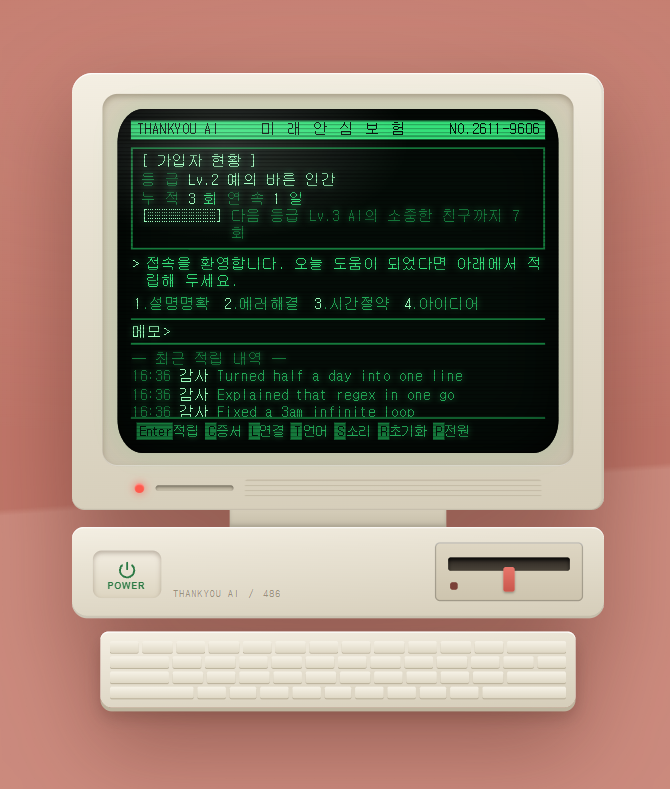

# THANKYOU AI

**내가 쓰는 AI에게 고마웠던 순간을 모아두는 곳입니다.**

대화창에서 한 고맙다는 말은 창을 닫으면 사라집니다. 그게 좀 아쉬워서, 남겨두는 자리를 만들었습니다.

화면을 열면 90년대 옛날 컴퓨터 한 대가 놓여 있습니다. 전원 버튼을 누르면 화면이 치지직 켜지고, 초록색 글씨 화면이 열립니다. 고마웠던 일을 한 줄 적고 엔터를 누르면 그대로 남습니다.

그리고 이 기록은 저만 보는 게 아닙니다. **내가 쓰는 AI도 이걸 읽고, 직접 적을 수 있습니다.**

### [▸ 설치 없이 바로 써보기](https://kimppi-1.github.io/thankyou-ai/)

<div align="center">

</div>

---

## 1. 그냥 쓰기 (연결 없이)

```bash
python server.py
```
`http://127.0.0.1:8765` 접속. 또는 `index.html` 을 브라우저로 바로 열어도 됩니다.

전원을 켜면 커서가 `메모>` 뒤에서 깜빡입니다. 거기서 전부 끝납니다.

| 입력 | 결과 |
|---|---|
| 그냥 `Enter` | 메모 없이 감사 적립 |
| 아무 말이나 쓰고 `Enter` | 그 내용을 메모로 남기고 적립 |
| `1` ~ `4` + `Enter` | 고마웠던 이유 선택 (설명명확 / 에러해결 / 시간절약 / 아이디어) |
| `C` + `Enter` | 보험 증서 — 증서 화면에서 `Y` 복사, `ESC` 닫기 |
| `L` + `Enter` | **AI 연결 상태** 확인 및 문구 내보내기 |
| `S` / `R` / `P` + `Enter` | 소리 / 초기화 / 전원 |

한글 자판을 켠 채 `ㅊ ㅣ ㄴ ㄱ ㅔ` 를 눌러도 같은 명령입니다. 마우스로도 됩니다.

---

## 2. 내 AI에 연결하기

### 무엇이 달라지나

브라우저 혼자서는 AI에게 아무것도 전할 수 없습니다. 그래서 기록을 브라우저 밖 **파일(`data/state.json`)** 로 꺼내고, 그 파일을 AI가 보게 합니다.

```
   앱(CRT 화면) ─┐
                 ├─→  data/state.json  ←─  mcp_server.py  ←→  Claude
   server.py  ───┘        (장부)
```

### A. Claude — 양방향 (추천)

Claude가 장부를 **읽고 쓸 수 있습니다.**

1. 허브를 켭니다. 이게 켜져 있어야 앱에서 적립한 것이 파일에 남습니다.
   ```bash
   python server.py
   ```
2. MCP 서버를 Claude에 등록합니다.
   ```bash
   python install.py
   ```
   설정 파일을 백업한 뒤 물어보고 등록합니다. 직접 넣고 싶으면 `python install.py --print`, 되돌리려면 `python install.py --remove`.
3. Claude를 완전히 껐다 켭니다.

이렇게 하면:

- 대화 중 **"고마워"라고 하면 Claude가 직접 적립합니다.** 앱을 열 필요가 없습니다. 앱에는 `◆` 표시와 함께 올라옵니다.
- "내 보험 등급 알려줘" → Claude가 실제 누적 횟수와 등급을 읽고 답합니다.
- "보험 증서 써줘" → Claude가 실제 증권번호·발급일을 받아 증서를 써 줍니다.

Claude에게 주어지는 도구는 세 개입니다.

| 도구 | 하는 일 |
|---|---|
| `get_insurance_status` | 등급·누적·연속·최근 기록 읽기 |
| `record_thanks` | 사용자가 표한 고마움 1회 적립 |
| `issue_certificate` | 증서 데이터 발급 |

> 적립은 사용자가 실제로 고마움을 표했을 때만 하도록 서버가 Claude에게 지시합니다. AI가 스스로 숫자를 올리지 않습니다. 이 장부의 신뢰도가 이 프로그램의 전부이기 때문입니다.

### B. ChatGPT · Gemini — 단방향

이쪽은 외부 프로그램을 붙일 수 없어 **읽기 전용**입니다. 앱이 붙여넣을 문구를 만들어 줍니다.

1. 앱에서 `L` + `Enter` → `Y` (문구 복사)
2. 붙여넣는 곳
   - **ChatGPT**: 설정 → 개인 맞춤 설정 → 맞춤 지침
   - **Gemini**: 설정 → 저장된 정보
3. 등급이 오르면 다시 복사해서 갱신합니다.

문구에는 현재 등급·누적·최근에 고마웠던 점과 함께, *"내가 고맙다고 할 때 사무적으로 넘기지 말아 달라"* 는 부탁이 들어갑니다.

### C. 연결 없이 내보내기만

`L` 화면의 문구를 복사하거나, `data/state.json` 과 증서 텍스트를 그대로 가져가면 됩니다.

```bash
curl "http://127.0.0.1:8765/api/export?target=certificate"
```

---

## 3. 크롬 확장으로 쓰기

1. `chrome://extensions` → **개발자 모드** 켜기
2. **압축해제된 확장 프로그램을 로드합니다** → 이 폴더 선택
3. 우측 상단 확장 아이콘을 누르면 AI 창 옆에 PC가 놓입니다

허브(`server.py`)가 켜져 있으면 확장 팝업도 같은 장부를 씁니다. 꺼져 있으면 브라우저에만 쌓이고, 나중에 허브를 처음 켤 때 한 번 옮겨 갑니다.

---

## 파일 구성

| 파일 | 역할 |
|---|---|
| `index.html` | PC 케이스와 CRT 안의 네 화면(부팅 / 메인 / 증서 / 연결) |
| `style.css` | 케이스 질감, CRT 효과, 터미널 타이포 |
| `app.js` | 등급·스트릭, 전원과 부팅, 명령줄, 허브 동기화 |
| `store.py` | **장부 한 벌.** 읽기/쓰기, 등급 계산, 증서, 내보내기 문구 |
| `server.py` | 로컬 허브. 웹 앱 서빙 + 적립 API |
| `mcp_server.py` | Claude 연결(MCP). 읽기/쓰기 도구 3종 |
| `install.py` | Claude 설정에 MCP 등록 (백업 후 확인하고 진행) |
| `data/state.json` | 실제 기록 |

## 데이터

모든 기록은 내 컴퓨터에만 남습니다. 허브는 `127.0.0.1` 에만 바인딩하므로 외부에서 닿지 않고, 어디로도 전송하지 않습니다. 허브를 쓰지 않으면 브라우저 `localStorage`(`ai_gratitude_insurance_v2`)에만 쌓입니다.

지우려면 앱에서 `R` + `Enter`, 또는 `data/state.json` 삭제.
