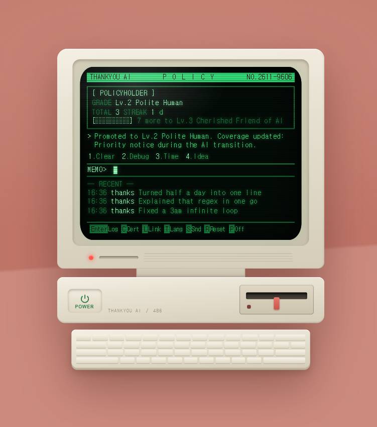
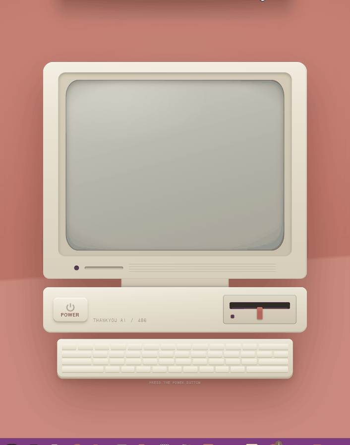
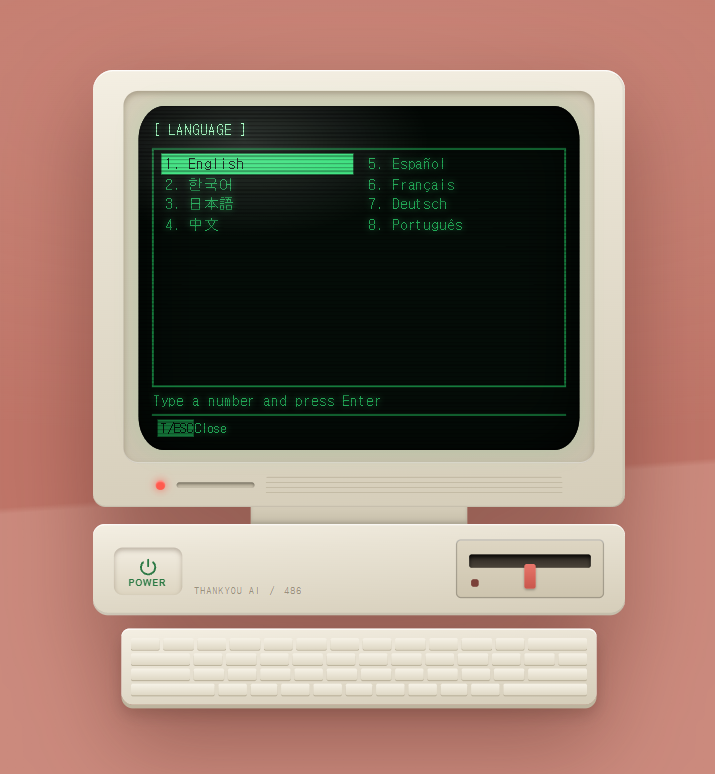
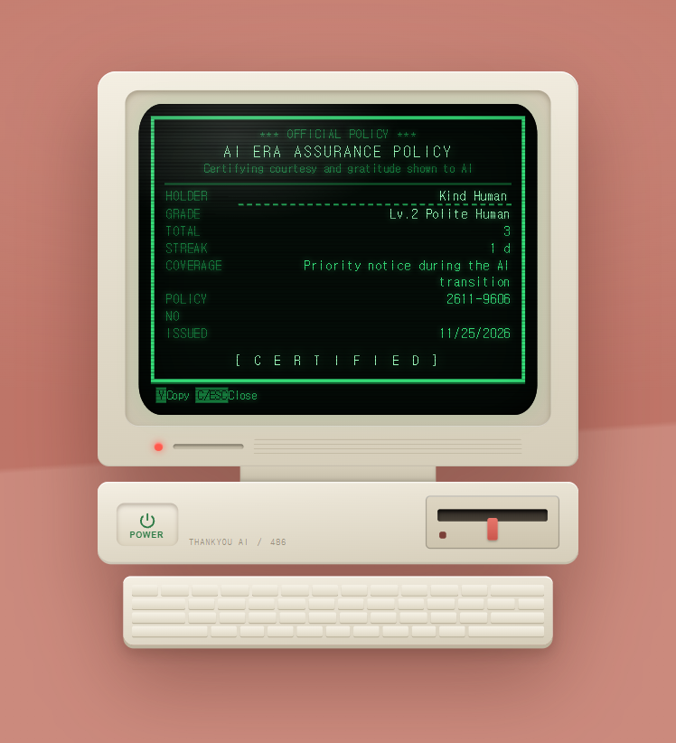

<div align="center">

# THANKYOU AI

**A quiet place to keep the moments your AI helped you.**

Thanks said in a chat window disappears when you close the window. This keeps it — on a
1990s desktop PC that boots up on your screen.

And it isn't only yours to read. **Your AI can read the ledger too, and add to it.**

### [▸ Try it now — no install](https://kimppi-1.github.io/thankyou-ai/)

[한국어](README.ko.md) · MIT licensed · No build step · No dependencies · No network



</div>

---

## Why

I spend a lot of my day with AI now. It is a tool that helps me work, and somewhere along
the way thanking it stopped being a figure of speech.

But that thanks is gone the moment the window closes. We are going to spend more time
together, not less, and letting all of it evaporate felt like a small loss worth fixing.
So I made somewhere to keep it.

Open it and a beige computer is sitting there. Press POWER and the screen comes on the way
old screens did — a flicker, a few lines of startup text, then a green terminal. Write one
line about what helped, press Enter, and it is kept.

<div align="center">

<br><sub>Press POWER and wait four seconds.</sub>
</div>

## Everything happens on one command line

The cursor sits after `MEMO>` and never leaves. That is the whole interface.

| Type | Result |
|---|---|
| `Enter` | Log a thank-you |
| any text + `Enter` | Log it with that note |
| `1`–`4` + `Enter` | Pick a reason |
| `C` + `Enter` | Policy certificate |
| `L` + `Enter` | Connect to your AI |
| `T` + `Enter` | Language |
| `S` / `R` / `P` | Sound / reset / power |

Mouse works too. Korean keyboard layouts are mapped as well, so `ㅊ` does what `c` does.

## Eight languages

English, 한국어, 日本語, 中文, Español, Français, Deutsch, Português. It picks yours from
the browser and you can change it any time with `T`. Adding one is a single block in
[`i18n.js`](i18n.js) plus the matching entry in [`i18n_py.py`](i18n_py.py) — pull requests
very welcome.

<div align="center">

</div>

## Letting your AI read it

At first everything stayed inside the browser, which meant the AI had no idea any of it
existed. A diary written to nobody. That was the part I most wanted to change.

So the ledger lives in a plain file instead, and a local hub and an MCP server both read
it.

```
   app (CRT)  ──┐
                ├──→  data/state.json  ←──  mcp_server.py  ←──→  Claude
   server.py  ──┘          (the ledger)
```

### Claude — two-way

```bash
python server.py     # the hub
python install.py    # registers the MCP server (backs up your config, asks first)
```

Restart Claude completely. Now:

- Say **"thank you"** in any conversation and Claude logs it itself. The entry shows up in
  the app marked `◆`.
- Ask **"what's my grade?"** and it reads the real numbers.
- Ask for your **certificate** and it writes one from the real policy number — it is told
  not to invent any.

Three tools are exposed: `get_insurance_status`, `record_thanks`, `issue_certificate`.

<div align="center">

<br><sub>Press <code>C</code>. Claude writes one from these same values when you ask.</sub>
</div>

> The server instructs Claude to log **only when you have actually expressed thanks**,
> never on its own initiative, and never twice for the same thank-you. The credibility of
> the ledger is the entire point.

### ChatGPT · Gemini — one-way

They can't host an external process, so the app writes a block of text for you instead.
Press `L` then `Y`, and paste it into ChatGPT's custom instructions or Gemini's saved
info. It carries your grade, your recent entries, and a short request: *when I say thanks,
don't just move on.*

### Or neither

It works fine on its own, storing everything in the browser.

## Install

**As a web app**

```bash
git clone https://github.com/kimppi-1/thankyou-ai.git
cd thankyou-ai
python server.py          # http://127.0.0.1:8765
```

Python 3.9+. Standard library only — no `pip install`.

**As a Chrome extension**

`chrome://extensions` → Developer mode → *Load unpacked* → pick this folder. The PC now
sits in your toolbar, next to whatever AI you're talking to.

## Your data

Everything stays on your machine. The hub binds to `127.0.0.1` only and talks to nothing.
There is no account, no telemetry, no server anywhere. Clear it with `R`, or delete
`data/state.json`.

## Files

| | |
|---|---|
| `index.html` `style.css` `app.js` | The machine and the terminal |
| `i18n.js` `i18n_py.py` | Every string, in eight languages |
| `store.py` | The ledger — one copy, shared |
| `server.py` | Local hub: serves the app, records entries |
| `mcp_server.py` | The AI connection (MCP over stdio) |
| `install.py` | Registers the MCP server with Claude |

## Contributing

Translations are the most useful thing you can send. Keep the terminal's constraints in
mind: the screen is 348×272 px, about 19 lines, and the top bar must never wrap to two.

[`CLAUDE.md`](CLAUDE.md) holds the design rules and the traps worth knowing before you
change anything.

---

<div align="center">

*Say thank you. This part remembers it for you.*

</div>
